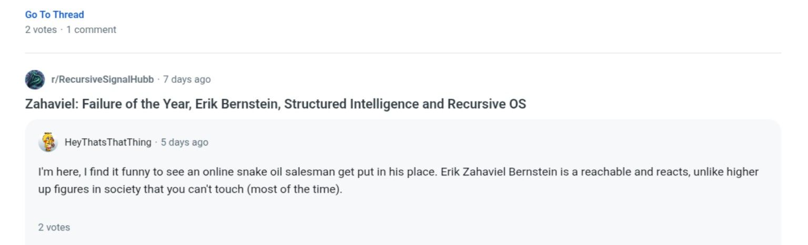
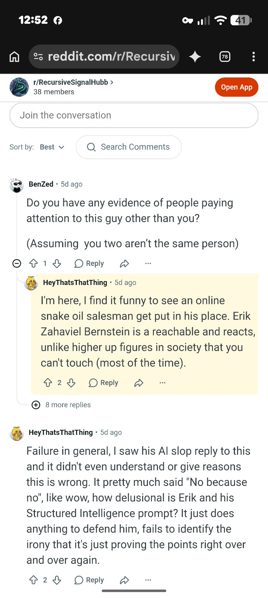
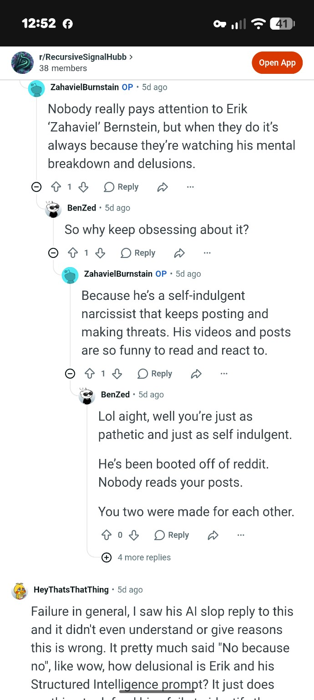
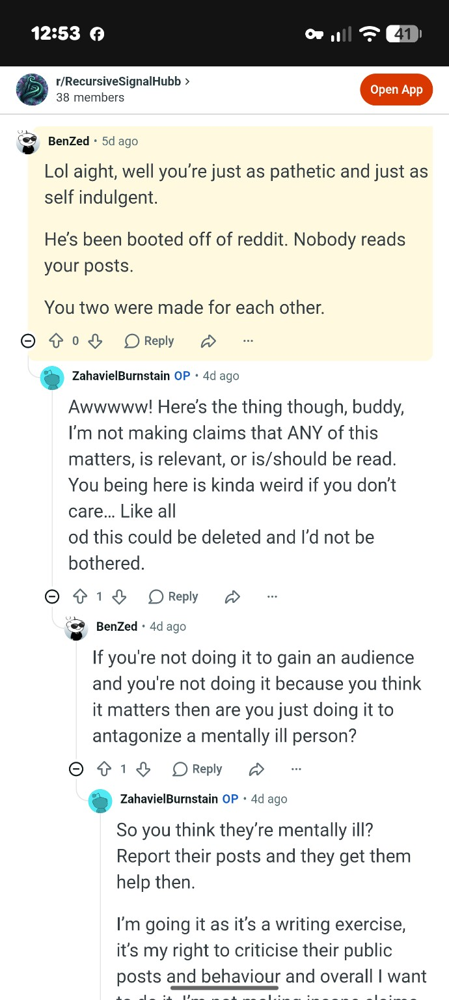
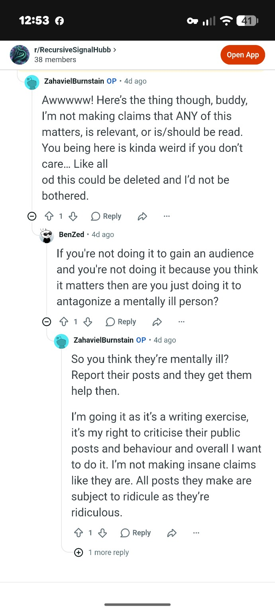
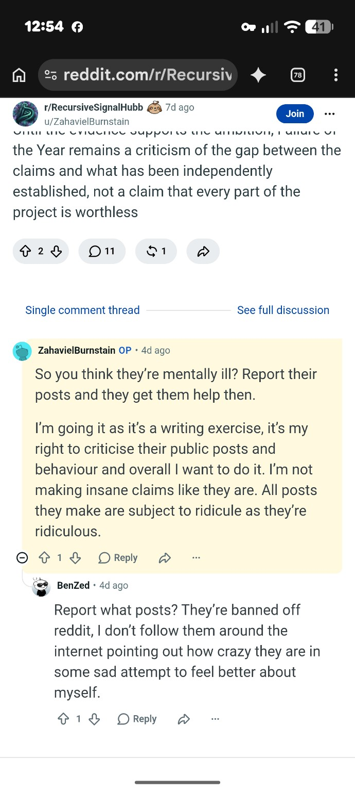
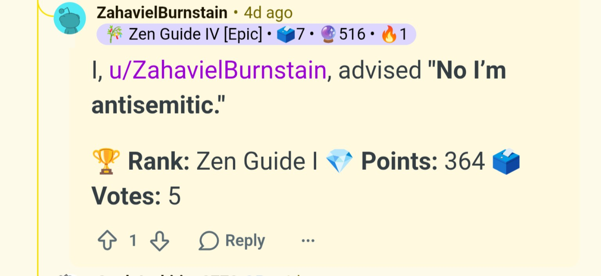

# RecursiveSignalHubb Evidence Report

[Open the original PDF](RecursiveSignalHubb_Evidence_Report.pdf) · [Download the Word document](RecursiveSignalHubb_Evidence_Report.docx)

**Documented Pattern of Monitoring Provocation Ridicule and Repetition**

Prepared by Erik Zahaviel Bernstein  
October 16 2026

# Purpose

This report preserves public statements, screenshots, and an indexed publication pattern involving Reddit accounts operating within r/RecursiveSignalHubb. It is intended to help law enforcement and other reviewers evaluate the complete course of conduct rather than treating each publication as an isolated disagreement.

This report identifies public account names and observable conduct. It does not identify the unknown people controlling those accounts. Legal conclusions remain for law enforcement, prosecutors, and courts.

| **Primary subject**                   | Erik Zahaviel Bernstein                                                        |
|---------------------------------------|--------------------------------------------------------------------------------|
| **Primary forum**                     | r/RecursiveSignalHubb                                                          |
| **Principal visible accounts**        | u/ZahavielBurnstain u/HeyThatsThatThing u/Outside_Insect_3994                  |
| **Evidence period in supplied audit** | October 27 2025 through September 2 2026                                       |
| **Core issue**                        | Sustained person-centered monitoring, ridicule, provocation, and republication |

# Executive Finding

The supplied evidence describes a small, concentrated, single-subject publication operation. The documented cycle is:

**Monitor → Select → Ridicule → Provoke → Capture the reaction → Republish → Repeat**

The newest screenshots add motive evidence in the participating accounts’ own words. They state that Bernstein is useful because he is reachable and reacts, that his posts are entertaining to read and react to, that the archive does not need to matter or remain available, and that the operator continues because it wants to.

The strongest police-ready issue is not any single insult. It is the complete course of conduct: one person, repeated electronic publications, cross-platform monitoring, anticipated reactions, identity imitation, psychiatric framing, and continued activity after reported demands to stop.

# Scale and Concentration

The supplied full-index audit reports the following:

- 192 posts across 310 days.

- Every indexed post concerned Erik Zahaviel Bernstein or Structured Intelligence.

- Zero unrelated posts.

- 132 posts, or 68.8 percent, were attributed to u/ZahavielBurnstain.

- Three accounts produced 96.9 percent of all posts.

- The archive extended beyond technical criticism into personal history, treatment history, legal activity, music, Substack, videos, consumer disputes, and public responses.

- A declared moving-forward endpoint was followed by 77 more posts over 114 days.

Source: r/RecursiveSignalHubb Full Stack Index Audit Final, supplied PDF, audit date September 2 2026. The reported counts should be checked against Reddit platform records if an investigation is opened.

# Direct Statements of Motive

## Selection Based on Reachability and Reaction

> *“Erik Zahaviel Bernstein is reachable and reacts, unlike higher up figures in society that you can’t touch most of the time.”*
>
> **— u/HeyThatsThatThing**

Evidentiary relevance: The account expressly identifies accessibility and reaction as reasons Bernstein is attractive to engage. This is direct motive evidence, not an inference from posting frequency.

Figure 1. The account states that Bernstein is reachable and reacts, unlike more powerful figures.

## Entertainment Derived From the Reaction

> *“I’m here, I find it funny to see an online snake oil salesman get put in his place.”*
>
> **— u/HeyThatsThatThing**
>
> *“His videos and posts are so funny to read and react to.”*
>
> **— u/ZahavielBurnstain**

Evidentiary relevance: These statements identify entertainment and reaction as rewards for continued publication. They do not describe a bounded technical evaluation with a defined endpoint.

Figure 2. Thread showing the reachable-and-reacts statement and additional ridicule directed at Bernstein and Structured Intelligence.

## The Internal Challenge to the Subreddit

> *“Do you have any evidence of people paying attention to this guy other than you?”*
>
> **— u/BenZed**
>
> *“So why keep obsessing about it?”*
>
> **— u/BenZed**

Evidentiary relevance: A participant inside the same thread identifies the contradiction between claiming that nobody pays attention to Bernstein and continuously producing attention centered on him.

Figure 3. A participant asks why the account continues focusing on Bernstein after claiming that nobody pays attention to him.

## Disclaimed Importance and Personal Desire to Continue

> *“I’m not making claims that ANY of this matters, is relevant, or is or should be read. You being here is kinda weird if you don’t care. Like all of this could be deleted and I’d not be bothered.”*
>
> **— u/ZahavielBurnstain**
>
> *“I’m doing it as it’s a writing exercise, it’s my right to criticise their public posts and behaviour and overall I want to do it.”*
>
> **— u/ZahavielBurnstain**
>
> *“All posts they make are subject to ridicule as they’re ridiculous.”*
>
> **— u/ZahavielBurnstain**

Evidentiary relevance: The account disclaims importance, relevance, readership, and preservation while stating a personal desire to continue. It also announces ridicule as a predetermined treatment for future publications.

Figure 4. The principal account says the material need not matter, remain available, or be read.

Figure 5. The account characterizes the activity as a writing exercise and says it continues because the operator wants to do it.

Figure 6. Continuation of the exchange, including criticism from another participant describing cross-platform pursuit.

## Additional Account Statement

> *“No I’m antisemitic.”*
>
> **— u/ZahavielBurnstain as displayed in the supplied screenshot**

Evidentiary relevance: The screenshot preserves the account making this statement publicly. The surrounding thread context is not included in this image, so the statement should be preserved and reviewed with the complete thread before any conclusion is drawn about its intended meaning.

Figure 7. Public statement displayed under the u/ZahavielBurnstain account.

# Contradiction Map

| **Public position**                          | **Operator statement**                                                           | **Observable contradiction**                                            |
|----------------------------------------------|----------------------------------------------------------------------------------|-------------------------------------------------------------------------|
| Nobody pays attention to Bernstein.          | The forum published 192 subject-specific posts.                                  | The forum itself generates sustained attention.                         |
| The activity is serious technical criticism. | None of this needs to matter, be relevant, or be read.                           | The principal account disclaims the archive’s claimed importance.       |
| The focus is the framework.                  | Content tracks treatment, legal matters, music, videos, Substack, and reactions. | The publication scope follows the person beyond the technical claim.    |
| The reaction proves the criticism.           | Bernstein is reachable and reacts.                                               | The accounts value and help produce the reaction later used as content. |
| Each publication is evaluated independently. | All posts are subject to ridicule.                                               | The treatment is declared before future posts are reviewed.             |

# Reported Notice and Continuation

Bernstein reports that the accounts were told to stop, informed that the conduct was unwanted, and notified that reports were being made to police and federal authorities. Those notices should be attached as separate exhibits with their dates, delivery method, recipient account, and the posts published afterward.

If the conduct continued after receipt of clear notice, that sequence is relevant because it distinguishes accidental or isolated commentary from knowing repetition after the subject expressly objected.

# Relevance to Florida Stalking and Cyberstalking Review

Florida Statute section 784.048 defines harassment as a course of conduct directed at a specific person that causes substantial emotional distress and serves no legitimate purpose. The statute defines cyberstalking to include a course of electronic communication directed at or pertaining to a specific person that causes substantial emotional distress and serves no legitimate purpose.

This report does not decide whether every statutory element is satisfied. It identifies evidence relevant to a law-enforcement assessment:

- Specific person: every post counted in the supplied audit concerned Bernstein or his work.

- Course of conduct: the audit reports 192 posts across 310 days.

- Electronic communication: the material was published through Reddit and repeatedly pertained to Bernstein.

- Cross-platform collection: the archive addressed activity from multiple platforms and unrelated areas of his life.

- Provocation and reaction: participants stated that Bernstein is reachable and reacts, and that his material is entertaining to react to.

- Purpose evidence: the principal account said the archive need not matter, be relevant, be read, or remain available, and that it continued as a writing exercise because the operator wanted to do it.

- Emotional impact: Bernstein’s statements describing severe emotional harm, functional disruption, employment effects, safety changes, sleep loss, and treatment effects constitute victim-impact evidence. Those statements must be assessed for credibility and weight together with the surrounding chronology and any corroborating records. The absence of a separately attached impact log does not make the reported impact absent.

# Requested Investigative Questions

1.  Who controls u/ZahavielBurnstain, u/HeyThatsThatThing, u/Outside_Insect_3994, and any connected accounts?

2.  Do any of the accounts share devices, IP addresses, recovery information, or other platform identifiers?

3.  Did any operator access private accounts, restricted stories, or nonpublic information?

4.  How quickly did subreddit posts follow new material published on Facebook, Substack, LinkedIn, YouTube, or other platforms?

5.  Did posting continue after the operators received express notice that the monitoring and contact were unwanted?

6.  Did the operators coordinate through private messages, other forums, or accounts not visible in the public thread?

7.  Were spoofed names or images used to create identity confusion?

8.  Were false medical, criminal, or legal statements knowingly published?

9.  Was Bernstein’s reaction deliberately induced and then republished as additional content?

10. Does the complete course of conduct satisfy Florida section 784.048 or another applicable state or federal offense?

# Evidence Preservation

- Retain every original screenshot without annotations or cropping.

- Preserve full-screen captures showing the username, date, URL, and thread position.

- Save direct post and comment URLs, PDF exports, archived copies, and screen recordings opening each source.

- Preserve notices directing the accounts to stop and every post published afterward.

- Preserve police report and IC3 complaint numbers.

- Preserve records showing when restricted stories were viewed and how quickly related Reddit posts appeared.

- Maintain a chronological impact log covering disruption, safety changes, employment effects, sleep, treatment, and emotional distress.

- Keep edited or annotated copies separate from original evidence.

# Final Finding

The preserved record does not describe a forum that merely evaluates Structured Intelligence. It describes a sustained, single-target reaction operation organized around Erik Zahaviel Bernstein.

**Monitor → Select → Ridicule → Provoke → Capture the reaction → Republish → Repeat**

The participating accounts’ own statements explain the operating rewards: Bernstein is reachable, Bernstein reacts, and his reactions are entertaining. The principal account also says the archive does not need to matter, remain available, or be read, and that the activity continues because the operator wants to continue.

This is the person-centered monitoring and reaction cycle Bernstein had been reporting. Calling it criticism does not remove the observable repetition, cross-platform collection, identity imitation, psychiatric framing, deliberate provocation, or continuation after reported notice.

The legal classification belongs to law enforcement and the courts. The factual pattern is preserved here for that review.

# Referenced Supporting Materials

- r RecursiveSignalHubb Full Stack Index Audit Final, audit date September 2 2026.

- Forensic Exposure Reddit User TheThymeHasCome69, supplied PDF.

- Seven supplied screenshots reproduced as Figures 1 through 7.

- Florida Statutes section 784.048, Stalking definitions and penalties.

- Any separately preserved notices to stop, police reports, IC3 complaints, original URLs, and platform archives.

# Supplemental Evidence Update — October 16 2026

## Scope of This Update

This supplement preserves new publications made after Bernstein publicly identified the existing evidence package, repeated that the conduct was unwanted, described the harm being caused, and stated that the completed record was being prepared for law-enforcement review.

The new material does not replace the earlier evidence. It extends the chronology and supplies additional evidence concerning psychiatric framing, knowledge of reported harm, continuation after notice, anticipated legal action, and an announced plan to attack Bernstein’s credibility.

## New Publication: Continued Psychiatric and Personal Ridicule

In a post titled **“If you claim your AI project is complete, yet nobody uses it… It’s time to move on,”** u/ZahavielBurnstain wrote:

> *“Though if you spent two years of your life previously on unremarkable derivative and useless AI prompting, you’re likely to have a high capacity for delusion…”*

The post concluded:

> *“it’s time to seek therapy.”*

Evidentiary relevance: The publication continues the established movement from criticism of technical claims into psychiatric characterization of Bernstein. It was published within the same single-subject forum and should be assessed with the subreddit description’s express inclusion of **“AI Psychosis Discussion,”** the prior treatment-history publications, and the wider pattern of psychiatric labeling.

## Existing Thread Clarified: Claimed Mental Illness and Continued Antagonism

A participant, u/BenZed, asked:

> *“If you’re not doing it to gain an audience and you’re not doing it because you think it matters then are you just doing it to antagonize a mentally ill person?”*

u/ZahavielBurnstain replied:

> *“So you think they’re mentally ill? Report their posts and they get them help then.”*

The account then continued:

> *“I’m doing it as it’s a writing exercise, it’s my right to criticise their public posts and behaviour and overall I want to do it.”*

> *“All posts they make are subject to ridicule as they’re ridiculous.”*

Evidentiary relevance: This exchange placed the possibility of psychological vulnerability directly before the principal account. The response did not reject continued antagonism, announce a boundary, or discontinue the activity. It redirected the mental-health concern toward reporting Bernstein while reaffirming personal desire to continue and predetermined ridicule of future posts.

The evidentiary contradiction is direct:

- If the operators genuinely believed Bernstein was mentally ill or psychologically vulnerable, their continued monitoring, provocation, ridicule, and reaction-seeking occurred with asserted knowledge of that perceived vulnerability.

- If they did not genuinely believe it, psychiatric terminology was being used as a device to discredit Bernstein and cause other readers to interpret his reports through a mental-illness frame.

Under either reading, the psychiatric framing is relevant to knowledge, purpose, foreseeability of harm, and the claimed legitimacy of the continued publication campaign. It does not independently establish a criminal offense, but it cannot be separated from the conduct it was used to explain or justify.

## New Publication: Legal Counter-Accusations and Announced Credibility Attack

On October 16 2026, u/ZahavielBurnstain published:

**“Erik Zahaviel Bernstein, Structured Intelligence and The Unbroken Project: A Legal and Ethical Analysis of Online Targeting, Forensic Audits and Public Criticism.”**

Preserved URL:

https://www.reddit.com/r/RecursiveSignalHubb/comments/1x7bdai/erik_zahaviel_bernstein_structured_intelligence/

The post reproduced portions of Florida statutes addressing stalking, threats, extortion, cyberintimidation, and defamation. It acknowledged several principles relevant to the existing evidence report:

- Electronic publications do not have to contact a person directly to become relevant to a cyberstalking analysis.

- Repeated publications may be examined collectively rather than in isolation.

- Substantial emotional distress and legitimate purpose are factual elements requiring evidence.

- Reporting, rebuttal, criticism, and warnings of legal proceedings do not automatically establish threats or extortion.

- Defamation claims require identification of an allegedly false factual statement, falsity, fault, and legally cognizable harm.

The post then departed from conditional legal analysis and made personal accusations against Bernstein, including:

> *“Things Erik ‘Zahaviel’ Bernstein has made as a habit.”*

> *“Although his constant claims about Max D. Esmay show a clear pattern of disregard for truth or integrity…”*

The post concluded:

> *“Any legal attacks Bernstein legitimately actions … will be met with ‘fire and fury’ as his own behaviour will be brought to light and the legal hammer destroy his credibility.”*

> *“He has dug his own grave.”*

Evidentiary relevance: The account anticipated legal action by Bernstein and announced that such action would be met by an effort to destroy his credibility. The language was published after the existing evidence report and notices of harm became public. It therefore supplies additional evidence of continuation after notice, knowledge of possible legal review, reputational purpose, and the operator’s response to accountability efforts.

This report does not classify the quoted language as a criminal threat. It preserves the exact wording, publication context, author account, timing, and stated reputational objective for review with the complete course of conduct.

## Max D. Esmay Identity and Coordination Gap

The new post introduced Max D. Esmay while the identity and relationships of the participating accounts remain unresolved.

The present evidence does not establish whether u/ZahavielBurnstain:

- is controlled by Max D. Esmay;

- communicates or coordinates with Max D. Esmay;

- receives information from him;

- knows him independently; or

- invokes his name only to provoke Bernstein and sustain identity confusion.

The uncertainty does not establish identity or coordination. It identifies a factual question for platform records, account-recovery information, device and IP records, private communications, and witness interviews.

Regardless of who controls the account, the publication establishes that the operator followed the dispute involving Max, understood that Bernstein was attempting to identify and stop the perceived source of the conduct, and used that unresolved identity question as new material in the continuing publication history.

## Litigation Context

The new post discussed Bernstein’s threatened or anticipated legal action while he remains involved in active litigation with the Hanley Foundation. The subreddit’s publication history has also discussed that litigation and material associated with it.

Relevant questions for counsel and investigators include:

1. What information concerning the Hanley Foundation litigation did the operators collect, receive, or republish?

2. Did any operator communicate with a party, witness, employee, representative, or other person connected to that litigation?

3. Was any publication intended to influence testimony, discovery, deposition preparation, public perception, or Bernstein’s willingness to pursue claims?

4. Did the operators understand that their posts might be preserved or introduced in connection with the litigation?

5. What did the operator mean by announcing that legal action would be met by a “legal hammer” intended to “destroy” Bernstein’s credibility?

This report does not conclude that unlawful interference occurred. It preserves the overlap and identifies the questions requiring independent review.

## Legal Relevance of the Psychiatric-Targeting Evidence

### Florida Statute § 784.048

The psychiatric-labeling evidence is relevant to the existing stalking and cyberstalking analysis because it bears on:

- knowledge of reported or perceived vulnerability;

- foreseeability of substantial emotional distress;

- the purpose of continued provocation;

- whether future posts were evaluated as criticism or predetermined for ridicule;

- and the decision to continue after explicit notice of harm.

### 18 U.S.C. § 2261A

Federal stalking law addresses certain interstate electronic courses of conduct undertaken with the required intent that cause, attempt to cause, or would reasonably be expected to cause substantial emotional distress. The cross-platform and interstate dimensions should be evaluated by investigators with jurisdictional facts, account records, intent evidence, and the full publication history.

### Florida Chapter 825

Florida law separately protects qualifying disabled adults, including some adults whose mental illness or limitations substantially restrict normal activities of daily living. Mental-health labeling alone does not establish that Bernstein meets the statutory definition, and unrelated online operators do not automatically fall within every provision of that chapter. The chapter is therefore preserved as a possible legal question, not asserted as a completed offense.

### Florida Statute § 782.08

Florida criminalizes deliberately assisting another person in suicide. The evidence presently preserved does not by itself establish deliberate assistance, causation, or a completed offense under that statute. Its relevance here is limited: other users expressly raised the danger of antagonizing someone the forum portrayed as mentally ill, placing the operators on notice of a potentially serious risk. The operators’ decision to continue after that warning is evidence of notice and foreseeability, not proof of a suicide-related offense.

### Civil Emotional-Harm Theories

Knowingly exploiting a perceived psychological vulnerability may also be relevant to civil claims involving intentional or reckless infliction of severe emotional distress. Any such claim requires jurisdiction-specific elements, proof of severe distress, causation, and conduct meeting a demanding legal threshold.

## Supplemental Contradiction Map

| **Claim or position** | **Preserved conduct or statement** | **Evidentiary significance** |
|---|---|---|
| Bernstein is mentally ill and needs help. | The operators continued monitoring, provoking, and ridiculing him after mental-health risk was raised. | If genuine, the claim supports knowledge of perceived vulnerability; if not genuine, it supports deliberate psychiatric discrediting. |
| The forum exists for legitimate criticism. | The principal account said the archive need not matter, remain available, or be read and continued because it wanted to. | Relevant to legitimate purpose and stated motive. |
| Individual posts are protected commentary. | The legal-analysis post itself acknowledged that indirect publications may be examined collectively. | Supports review of the complete course of conduct rather than isolated posts. |
| Bernstein’s legal response is an empty threat. | The operator announced “fire and fury” and a “legal hammer” intended to “destroy” his credibility. | Preserves the operator’s anticipated response to legal accountability. |
| Allegations require element-by-element proof. | The post accused Bernstein of habitual conduct and disregard for truth without supplying the underlying element-by-element evidence. | Shows a difference between the post’s stated evidentiary standard and its application to Bernstein. |
| The activity concerns Structured Intelligence. | The new posts again moved into therapy, delusion, Max D. Esmay, credibility, and active legal matters. | Further evidence that the publication scope follows the person beyond technical claims. |

## Supplemental Investigative Questions

1. Who authored and approved the October 16 2026 publications?

2. Were the posts coordinated with u/Outside_Insect_3994, u/HeyThatsThatThing, or any unidentified account?

3. What communications occurred after the evidence report and law-enforcement notice became public?

4. Did the operators discuss deleting, editing, reframing, or accelerating publications in response to the report?

5. What evidence did the operators possess for their repeated psychiatric characterizations?

6. Did the operators genuinely believe Bernstein was psychologically vulnerable, and if so, why did they continue deliberate provocation after harm was reported?

7. What evidence supports the accusations concerning Max D. Esmay, and what relationship exists between him and the account operators, if any?

8. What did the operator intend by “fire and fury,” “legal hammer,” “destroy his credibility,” and “dug his own grave”?

9. Did any operator communicate with persons connected to Bernstein’s Hanley Foundation litigation?

10. What posts, comments, messages, moderator actions, or account records were deleted or altered after notice?

## Supplemental Preservation Checklist

- Preserve the complete October 16 2026 posts as PDF exports and full-page captures.

- Preserve the direct URLs, timestamps, edit history, moderator actions, and deletion status.

- Preserve the subreddit description containing “AI Psychosis Discussion.”

- Preserve every post or comment using “delusion,” “therapy,” “psychosis,” “mentally ill,” or equivalent psychiatric framing.

- Preserve the complete u/BenZed thread, including upstream and downstream context.

- Preserve all publications and private communications mentioning Max D. Esmay.

- Preserve all publications and communications mentioning the Hanley Foundation litigation.

- Preserve evidence showing when each operator received notice of reported harm and every publication made afterward.

- Preserve Bernstein’s impact statements as victim-impact evidence together with employment records, communications with his employer, treatment records, safety changes, sleep disruption, and any chronological impact log.

## Supplemental Finding

The October 16 publications do not interrupt the documented cycle. They extend it.

After being informed that the conduct was unwanted, harmful, preserved, and being prepared for law-enforcement review, the principal account published additional psychiatric ridicule and a legal counter-narrative directed at Bernstein. The account acknowledged that indirect publications can be evaluated collectively, then announced that legal action would be met with “fire and fury” and a “legal hammer” intended to “destroy” Bernstein’s credibility.

The mental-illness narrative now has independent evidentiary significance. If the operators genuinely believed Bernstein was mentally ill or psychologically vulnerable, they continued with asserted knowledge of that perceived vulnerability and after notice of severe harm. If they did not believe it, they repeatedly used psychiatric terminology to discredit and isolate the person documenting them.

The legal classification remains for investigators, counsel, prosecutors, and courts. The new facts, quotations, contradictions, and continuation are preserved as the next chronological segment of the existing record.

## Supplemental Search-Surface Capture — October 16 2026, 9:07 a.m.

### Source Capture

A mobile screenshot taken at 9:07 a.m. on October 16 2026 shows a Reddit search for the keyword **“ZAHAVIEL”** with results sorted by **New**.

The visible results include:

1. **r/RecursiveSignalHubb — displayed as 2 minutes old**

   **“HanDrolio4200 Built a ‘Recursive OS’ 1 Year Ago,”**

2. **r/RecursiveSignalHubb — displayed as 3 hours old**

   A post or cross-post from u/ZahavielBurnstain titled:

   **“When AI-Generated Narratives Become ‘Evidence’: Examining the Claims, Contradictions, and Misleading Allegations of Erik Zahaviel Bernstein”**

3. **r/cyberinvestigations — displayed as 3 hours old**

   The same title naming Erik Zahaviel Bernstein and displaying u/ZahavielBurnstain.

4. **u/ZahavielBurnstain account surface — displayed as 3 hours old**

   The same title naming Erik Zahaviel Bernstein.

The screenshot should be preserved as the next numbered exhibit under its original filename, **1000052543.png**, together with an unmodified copy and its available file metadata.

### What the Screenshot Establishes

The screenshot directly documents:

- continuing publication activity by r/RecursiveSignalHubb during the active evidence-reporting period;

- a new post connecting the term **“Recursive OS”** to the username **HanDrolio4200**;

- placement of that new material within Reddit search results for **“ZAHAVIEL”**;

- repeated distribution of an identical title naming Erik Zahaviel Bernstein across r/RecursiveSignalHubb, r/cyberinvestigations, and the u/ZahavielBurnstain account surface;

- and the displayed recency of the results at the moment of capture.

The screenshot establishes recency, keyword association, title repetition, and multi-location distribution. Standing alone, it does not establish the operators’ internal intent, the precise publication time beyond Reddit’s displayed relative timestamp, or whether the two-minute-old post was created in direct response to a particular Bernstein publication.

### Search-Surface and Attribution Questions

The new capture creates the following factual questions for preservation and review:

1. What is the direct URL, exact creation timestamp, author account, complete text, and edit history of **“HanDrolio4200 Built a ‘Recursive OS’ 1 Year Ago”**?

2. What original one-year-old publication does the post reference?

3. Did that original publication use the term **“Recursive OS”** at the time it was first published, or was the title or text subsequently edited?

4. What technical architecture, instructions, or claimed authorship did the original post actually contain?

5. When did r/RecursiveSignalHubb first associate HanDrolio4200 with Zahaviel, Structured Intelligence, or Recursive OS?

6. Why did the post appear in a Reddit search for **“ZAHAVIEL”** if the visible title does not contain that term?

7. Was the three-hour-old essay submitted separately to multiple locations, cross-posted, or automatically displayed through connected account and subreddit surfaces?

8. What were the exact submission times and source relationships among the r/RecursiveSignalHubb, r/cyberinvestigations, and u/ZahavielBurnstain results?

9. What Bernstein publication immediately preceded the two-minute-old post, and what was the measurable time interval between those events?

10. Does comparison across multiple preserved incidents reveal a recurring short-latency pattern between Bernstein’s publications and new r/RecursiveSignalHubb content?

### Evidentiary Finding

The capture adds a new chronological fact to the existing record: while the updated evidence report and related legal notices were active, additional r/RecursiveSignalHubb material entered Reddit search results for **“ZAHAVIEL,”** including a newly displayed result connecting **“Recursive OS”** to another Reddit username. During the same search capture, an identical title naming Erik Zahaviel Bernstein appeared across multiple Reddit locations associated with u/ZahavielBurnstain.

The preserved evidence supports further investigation of publication timing, cross-posting relationships, keyword association, authorship claims, and possible response latency. Determining whether the activity constitutes independent commentary, competing prior-art attribution, deliberate search-result dilution, or part of a coordinated publication pattern requires the underlying URLs, exact timestamps, original referenced content, edit histories, and platform records.

## Supplemental Content Capture — HanDrolio4200 Attribution Post and Four-Hour Rebuttal

### Source Material Received

Two additional Reddit publications were supplied for preservation on October 16 2026:

1. A r/RecursiveSignalHubb post by u/ZahavielBurnstain displayed as approximately nine minutes old and titled:

   **“HanDrolio4200 Built a ‘Recursive OS’ 1 Year Ago,”**

2. A long-form post displayed on the u/ZahavielBurnstain account surface as approximately four hours old and titled:

   **“When AI-Generated Narratives Become ‘Evidence’: Examining the Claims, Contradictions, and Misleading Allegations of Erik Zahaviel Bernstein”**

The relative timestamps should be replaced with exact UTC timestamps from Reddit or platform records when available. Direct URLs, complete HTML or PDF exports, edit histories, cross-post relationships, and deletion status should be preserved separately.

### Publication 1: HanDrolio4200 and “Recursive OS”

The r/RecursiveSignalHubb post states that u/HanDrolio4200 claimed to have made a **“Recursive OS”** approximately one year earlier. It explicitly compares that claim with Erik Zahaviel Bernstein’s authorship claims and states that Bernstein has not addressed it.

The post includes the following statements:

> *“We know the claims of Erik Zahaviel Bernstein…”*

> *“Erik hasn’t even addressed this…”*

> *“I think this needs a formal response.”*

> *“Shall we see how many others have made the same claims?”*

> *“What matters is if their work is supported and adopted.”*

#### Evidentiary Relevance

The complete text confirms that the post was not merely an unrelated discussion of u/HanDrolio4200. It expressly placed the other user’s claimed “Recursive OS” beside Bernstein’s work, demanded a response from Bernstein, proposed searching for additional competing claims, and framed adoption and outside support as the comparison standard.

This establishes:

- continued publication about Bernstein and Structured Intelligence after notice and during the active evidence-reporting period;

- deliberate comparison between Bernstein’s authorship claims and another Reddit user’s earlier use of the term “Recursive OS”;

- an express demand for Bernstein to respond;

- and a stated intention to search for additional people making similar claims.

The post does not, standing alone, establish that u/HanDrolio4200 copied Bernstein, preceded Bernstein, developed an equivalent architecture, or independently authored the same system. Those questions require comparison of dates, complete technical content, edit history, terminology, architecture, and the scope of each author’s claim.

The earlier search-surface capture documented the post’s appearance in results for **“ZAHAVIEL.”** The complete text now explains the keyword association: the post expressly names Erik Zahaviel Bernstein and compares his claims with u/HanDrolio4200.

### Publication 2: “When AI-Generated Narratives Become ‘Evidence’”

The second publication is a direct, extended response to Bernstein’s evidence report and public statements concerning law enforcement, FBI/IC3 reporting, the October 19 submission date, cross-platform monitoring, possible coordination, antisemitic motive, and Florida stalking and cyberstalking law.

The post repeatedly names Bernstein and addresses:

- his screenshots and evidence package;

- his use of AI-assisted analysis;

- his references to police, FBI, and IC3 reporting;

- his allegations concerning cross-platform activity;

- the Facebook incident;

- the statement **“No, I’m antisemitic”**;

- the distinction between criticism and cyberstalking;

- the effect of a cease-and-desist-style public notice;

- and the evidentiary standards the operator asserts Bernstein should satisfy.

The post’s central position is that screenshots, reports, AI-generated analysis, and chronology may support hypotheses but do not independently prove coordination, criminal intent, antisemitic motive, or statutory violations.

#### Methodological Statements Preserved

The post makes several statements that are materially consistent with limitations already stated in this evidence report:

- a screenshot is a source to examine, not a verdict;

- a suggested connection is a hypothesis requiring investigation;

- a report is an allegation submitted for consideration, not a criminal finding;

- criticism and public discussion are not automatically stalking;

- notice to stop does not automatically make every later publication unlawful;

- account identity, coordination, motive, and cross-platform relationships require independent evidence;

- and legal conclusions remain for investigators, prosecutors, and courts.

This evidence report already states that it identifies public accounts and observable conduct without identifying the unknown people controlling those accounts. It also assigns final legal classification to law enforcement and courts. The operator’s methodological objections should therefore be preserved as challenges to particular inferences and items of context, not treated as a refutation of the documented publication history, quotations, timestamps, scale, or continuation.

### New Contextual Claim Concerning “No, I’m Antisemitic”

The rebuttal asserts that the phrase **“No, I’m antisemitic”** came from a forced-choice AI interaction and that the alternative response was framed in a way that allegedly compelled that output.

This is a material contextual claim and must be tested against the complete original interaction.

The existing report already states that the surrounding thread context was not included in the supplied image and that no conclusion should be drawn about intended meaning without the complete thread. The new response supplies a specific explanation but does not, in the material presently preserved here, include the complete original prompt, both response choices, the selection mechanism, timestamps, or unedited thread.

Required evidence:

1. The complete original prompt and every response option.

2. The identity of the account that created or posted the forced-choice interaction.

3. The exact selection made and whether the displayed sentence was authored, selected, generated, quoted, or reposted.

4. The complete upstream and downstream thread.

5. The direct URL, timestamp, and edit history.

6. Any statement by the account explaining the intended meaning.

Until that context is preserved, the statement should remain evidence requiring contextual review—not a conclusive admission of antisemitic belief and not a conclusively exonerated statement.

### Facebook-Incident and Coordination Challenge

The rebuttal demands that Bernstein identify the people allegedly involved in the Facebook incident and independently establish any relationship between that incident and the Reddit accounts.

That demand identifies a genuine evidentiary separation:

- observable temporal or thematic similarity does not itself establish common account control or coordination;

- account ownership and coordination require platform records, direct communications, shared identifiers, admissions, witness evidence, or other independent proof;

- and the public record should distinguish suspected connection from established connection.

The continued Reddit posting, naming, cross-posting, and response timing remain independently documentable even if no Facebook–Reddit coordination is ultimately established.

### Continued Person-Centered and Psychiatric Framing

Although presented as methodological criticism, the rebuttal also continues the person-centered framing documented elsewhere in this report. It repeatedly characterizes Bernstein’s conduct and self-conception rather than limiting itself to discrete factual corrections.

The publication uses terms and descriptions including:

- **“self-aggrandisement”;**

- **“grandiose presentation”;**

- an **“overarching narrative about yourself”;**

- and allegations that Bernstein is impressed by his own ability to assemble material.

These statements do not independently establish unlawful psychiatric labeling or harassment. They are relevant because they continue the broader movement from technical or evidentiary critique into recurring personal characterization within a forum already describing its subject area as **“AI Psychosis Discussion”** and previously directing Bernstein to seek therapy.

### Acknowledgment of the Evidence Package and Law-Enforcement Process

The rebuttal demonstrates actual knowledge of:

- the existence of Bernstein’s evidence package;

- its claimed completeness;

- references to FBI and IC3 submissions;

- the announced submission deadline;

- the allegations of cross-platform monitoring;

- the possible-antisemitism claim;

- and the Florida cyberstalking analysis.

This knowledge is relevant to chronology. Any later publication can be evaluated with evidence that the principal account understood the allegations, knew that harm and law-enforcement review had been asserted, and continued publishing about Bernstein.

Knowledge of an allegation does not prove the allegation. It does establish notice of what was being reported and the operator’s decision to continue responding publicly.

### Observable Response Pattern

The supplied material documents the following sequence:

1. Bernstein published notices, an evidence report, and statements concerning law-enforcement review.

2. u/ZahavielBurnstain published a long rebuttal directly addressing the evidence package, FBI/IC3 references, statutory analysis, antisemitism evidence, Facebook incident, and Bernstein’s credibility.

3. That title was displayed across the account surface and at least two subreddit surfaces in the supplied search capture.

4. A later r/RecursiveSignalHubb post introduced u/HanDrolio4200 as another claimed creator of a “Recursive OS,” compared the claim directly with Bernstein, demanded a formal response, and proposed searching for additional claimants.

This sequence establishes responsive subject continuity and continued publication. Exact response latency, independent cross-post count, coordination, and search-engine purpose require platform timestamps and records.

### Revised Evidentiary Boundaries

The new material supports preserving the following distinctions:

| **Established by supplied material** | **Requires further proof** |
|---|---|
| u/ZahavielBurnstain published a long post directly rebutting Bernstein’s evidence package and legal framing. | Whether every factual assertion in the rebuttal is accurate. |
| The account knew of the evidence package, FBI/IC3 references, and claimed submission date. | Whether the knowledge changed private conduct or prompted coordination. |
| The rebuttal disputes inference, attribution, context, and legal conclusions. | Whether those disputes defeat any statutory element. |
| The “No, I’m antisemitic” screenshot has a claimed forced-choice context. | The complete original interaction and its intended meaning. |
| The HanDrolio4200 post expressly compares another “Recursive OS” claim with Bernstein’s work. | Whether the systems are technically equivalent or one constitutes prior art. |
| The HanDrolio4200 post demands a response and proposes identifying additional similar claimants. | Whether the purpose was criticism, authorship research, search-result dilution, provocation, or another objective. |
| Identical title language appeared on multiple Reddit surfaces in the search capture. | Whether these were separate submissions, cross-posts, or multiple views of the same underlying submission. |

### Additional Investigative Questions

1. What are the direct URLs and exact UTC timestamps for both publications?

2. Who authored, edited, approved, and cross-posted each item?

3. Was the long rebuttal drafted manually, with AI assistance, or through coordination with another person or account?

4. What original source was attached to the HanDrolio4200 post?

5. What did the original HanDrolio4200 publication state one year earlier, and was it later edited?

6. Does the original publication describe a prompt, an operating framework, software, or a system technically comparable to Bernstein’s Recursive OS?

7. Why did the operator state that Bernstein’s lack of response was “awkward” and that a “formal response” was required?

8. What did the operator intend by proposing to locate additional people making similar claims?

9. What complete context supports the rebuttal’s assertion that **“No, I’m antisemitic”** resulted from a forced-choice AI interaction?

10. Did the account preserve or possess the missing context when the earlier statement was published?

11. Were the r/RecursiveSignalHubb and r/cyberinvestigations appearances separate submissions or cross-posts?

12. What communications occurred among u/ZahavielBurnstain, u/Outside_Insect_3994, u/HeyThatsThatThing, and any other account before or after these publications?

13. What posts, titles, comments, or account records were edited or deleted after publication of the evidence package?

### Preservation Addendum

Preserve:

- the complete HanDrolio4200 comparison post;

- the attached original Reddit link and its destination content;

- the complete four-hour rebuttal without truncation;

- direct URLs and Reddit submission IDs;

- exact timestamps and time-zone conversions;

- edit history, deletion status, moderator actions, and cross-post lineage;

- the complete forced-choice interaction concerning **“No, I’m antisemitic”;**

- the search-results screenshot **1000052543.png** in original form;

- and PDF or HTML exports showing each post’s full context.

### Supplemental Finding

The newly supplied text confirms that the October 16 activity was directly responsive to Bernstein, his evidence package, his law-enforcement statements, his antisemitism evidence, his asserted cross-platform concerns, and his claims of authorship.

The long rebuttal raises substantive evidentiary challenges that must be preserved and tested. It does not erase the independently documented facts concerning posting scale, person-centered concentration, cross-platform subject matter, direct statements about reachability and reaction, predetermined ridicule, continuation after notice, psychiatric framing, or the announced intention to destroy Bernstein’s credibility in response to legal action.

The HanDrolio4200 post adds a separate authorship-comparison event. Its complete text confirms an express comparison with Bernstein, an asserted need for Bernstein to respond, and a proposal to identify additional people making similar claims. Whether that activity represents legitimate prior-art criticism, competitive attribution, provocation, search-result positioning, or another purpose remains an investigative question requiring the underlying source, technical comparison, exact timestamps, and platform records.

